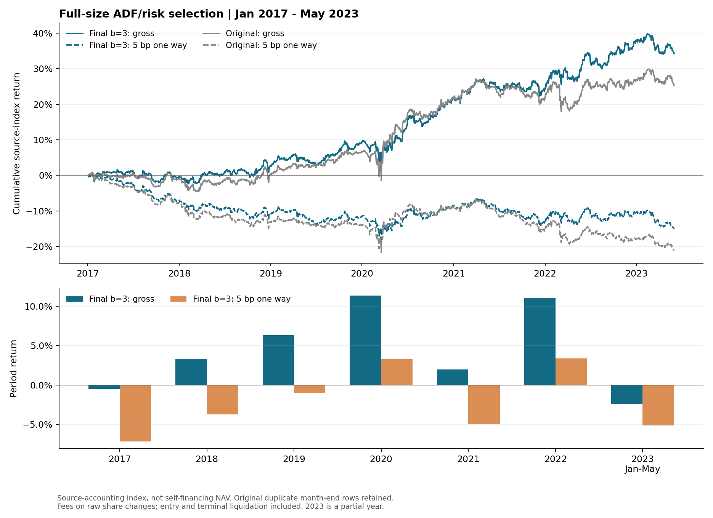

# 공적분 점수와 위험 제약을 이용한 제한적 중복 페어 트레이딩

최종 전략은 **`ADF_RISK3`**이다. 공적분 점수가 좋은 페어를 살리기 위해 한 종목을 최대 **3개 페어**에 포함할 수 있게 하되, 선정 시 추정한 포트폴리오 분산이 같은 달의 비중복 원전략보다 커지지 않도록 한다. **20페어 제한은 적용하지 않는다.** 월별 선정 수는 원전략과 같은 205~216개이다.

기대수익을 예측해 최대화하는 모형이 아니다. 목적함수는 **공적분 점수의 합**이며, 과거 수익은 위험 제약을 계산하는 데 사용한다. `SOURCE_M`, `ADF_RISK1`, `ADF_RISK2`는 비교를 위해 함께 제공한다. 최종 전략 선택과 분석은 이미 관찰한 2017~2023년 자료를 이용한 탐색적 연구이며, 독립적인 미관측 검증 성과를 의미하지 않는다.

이 저장소는 [Qureshi·Zaman의 선행논문](https://arxiv.org/abs/2403.07998)에서 영감을 받은 연구 확장이다. **공개 코드의 재현 규칙을 보존한 비교 실험**으로, 논문 표 자체의 정확한 재현이나 실전 투자계좌의 수익률을 주장하지 않는다.

## 비용 전후 결과

기간은 **2017-01-03~2023-05-31**이다. 기본 비용은 **편도 0.05% = 5bp**이며, 매수·매도 주문대금 전체에 적용한다. 최초 진입과 최종 청산도 포함한다. 아래 비용 후 결과는 **원재현 기준 비용 차감 수익지수**로, 자기금융 투자계좌의 NAV가 아니다. 기존 수익 계산을 유지한 비용 민감도 비교이다.

| 전략 | 비용 전 누적 | 5bp 후 누적 | 비용 전 변동성 | 5bp 후 변동성 | 5bp 후 최대낙폭 |
| --- | --- | --- | --- | --- | --- |
| 원전략 SOURCE_M | 25.39% | -21.11% | 5.94% | 5.94% | -22.04% |
| 비중복 ADF_RISK1 | 26.06% | -20.80% | 5.84% | 5.84% | -23.46% |
| 최대 2개 ADF_RISK2 | 30.47% | -17.85% | 5.79% | 5.79% | -22.13% |
| **최종 ADF_RISK3** | 34.36% | -15.01% | 5.72% | 5.73% | -19.26% |

최종 모형은 같은 비용 기준의 원전략보다 누적수익이 **6.10%p** 높지만, 기본 5bp 비용에서는 **누적 -15.01%의 손실**이다. 비용 전 수익 개선만으로 비용 후 수익성이 확보되었다고 판단할 수 없다.

누적수익은 계산 행의 수익률을 복리로 연결한 값이다. 변동성과 샤프는 원재현과 같이 계산 행에 연 252배를 사용한다. 무위험수익률은 0으로 둔다. 월말 중복이 포함되므로 이 연율화도 원재현 통계에 해당한다. 최대낙폭은 최초 지수 1을 포함한다.



## 기간별 수익

다음은 전체 실행을 이어서 보유한 상태의 **구간 수익**이다. 연초·구간 시작마다 현금으로 다시 시작하지 않는다. 최초 진입 비용은 2017년에, 최종 청산 비용은 2023년 5월에 포함한다. 2023년은 **1~5월만** 집계하며 연환산 수익으로 표시하지 않는다.

| 기간 | 원전략 비용 전 | 원전략 5bp 후 | 최종 비용 전 | 최종 5bp 후 |
| --- | --- | --- | --- | --- |
| 전체 2017-01-03~2023-05-31 | 25.39% | -21.11% | 34.36% | -15.01% |
| 2017~2019 | 6.60% | -13.98% | 9.26% | -11.59% |
| 2020~2023-05 | 17.63% | -8.29% | 22.97% | -3.87% |
| 원재현 기본 범위 2020-01-31~2023-05-31 | 20.11% | -5.83% | 25.29% | -1.53% |

원재현 기본 범위 행은 원래 2020년 1월 31일 이후의 선정 구간만 취한다. 시작일의 이전 선정 행은 제외하고 새 선정 행을 포함하며, 비용은 2017년부터 이어진 포지션의 전환 비용이다. **2020년에 현금에서 새로 시작한 백테스트가 아니다.**

| 연도 | 원전략 비용 전 | 원전략 5bp 후 | 최종 비용 전 | 최종 5bp 후 |
| --- | --- | --- | --- | --- |
| 2017 | -0.94% | -7.72% | -0.50% | -7.18% |
| 2018 | 1.36% | -5.70% | 3.31% | -3.73% |
| 2019 | 6.16% | -1.15% | 6.30% | -1.05% |
| 2020 | 14.23% | 5.86% | 11.33% | 3.25% |
| 2021 | -0.24% | -7.05% | 1.96% | -5.02% |
| 2022 | 4.37% | -2.93% | 11.04% | 3.37% |
| 2023 (1~5월) | -1.10% | -3.99% | -2.44% | -5.17% |

월별 전체 결과는 [monthly.csv](results/costs/monthly.csv), 연도별 전체 결과는 [yearly.csv](results/costs/yearly.csv), 구간별 결과는 [periods.csv](results/costs/periods.csv)에 있다. CSV 수익률 단위는 **1 = 100%**다. `gross_return`과 `net_return`은 수익률이며 금액이 아니다. 기간별 복리수익은 단순 합산하지 않는다.

## 비용률 민감도

| 편도 비용 | 원전략 | ADF_RISK1 | ADF_RISK2 | 최종 ADF_RISK3 |
| --- | --- | --- | --- | --- |
| 0bp (0.00%) | 25.39% | 26.06% | 30.47% | 34.36% |
| 1bp (0.01%) | 14.29% | 14.87% | 18.94% | 22.60% |
| 5bp (0.05%) | -21.11% | -20.80% | -17.85% | -15.01% |
| 10bp (0.10%) | -50.38% | -50.25% | -48.28% | -46.25% |

비용률은 실제 증권사 수수료를 추정한 값이나 논문의 SEC 연간 비용 가정을 복제한 값이 아니라, 이 연구에서 명시적으로 둔 **주문대금 비례 비용 가정**이다. 5bp를 왕복 비용으로 나누지 않는다. 공매도 대차료, 금융비용, 시장 충격, 최소 주문 수수료, 세금은 별도로 반영하지 않았다. 포함하지 않은 비용이 있으므로 완전한 실거래 비용으로 해석하지 않는다.

## 선정 모형

월별 후보 페어를 $e$, 선정 여부를 $z_e\in\{0,1\}$, 원전략의 비중복 선정을 $z^M$, 그 개수를 $K_m$이라 두면 다음 문제를 푼다.

$$
\begin{aligned}
\max_z\quad &\sum_e s_ez_e,\qquad s_e=-t_e^{\mathrm{ADF}},\\
\text{s.t.}\quad &\widehat{\operatorname{Var}}_{252}(R(z))\le
\widehat{\operatorname{Var}}_{252}(R(z^M)),\\
&\sum_{e:i\in e}z_e\le b\quad\forall i,\\
&\sum_e z_e=K_m,\qquad z_e\in\{0,1\}.
\end{aligned}
$$

최종 전략은 $b=3$, 비교 전략은 $b=1,2$이다. $K_m$은 해당 달의 원전략 선정 개수이며 20이나 100으로 고정하지 않는다. ADF 통계량이 더 음수일수록 점수가 커진다. 이 점수는 미래 수익이나 수익 확률이 아니다.

위험 계산은 같은 날짜에서 원코드의 페어별 손익 $\pi_{e,t}$와 자본 $d_{e,t}$를 합산한다.

$$
R_t(z)=\frac{\sum_e z_e\pi_{e,t}}{\sum_e z_ed_{e,t}},\qquad
d_{e,t}=|Q_{e,t}|\big(P_{y,t}+|\beta_{e,t}|P_{x,t}\big).
$$

따라서 페어별 비중은 $w_{e,t}=z_ed_{e,t}/\sum_fz_fd_{f,t}$로 매일 달라진다. 페어를 동일 자본으로 재배분하거나, 주가·헤지비율·Q 크기에 따른 자본 가중을 제거하지 않았다. 고정 비중의 $w^\top\Sigma w$로 위험을 대신 계산하지도 않는다. 선정일을 포함한 직전 252개 관측치의 표본분산(`ddof=1`)을 사용하고, 합계 자본이 0인 학습 행만 현금 수익 0으로 처리한다. 비용은 선정 완료 후 평가에 추가하며, 최적화 목적이나 위험 상한에 들어가지 않는다.

| 조건 | 적용 방식 |
|---|---|
| 가격 입력 | 고정된 원가격 3,388행 × 505종목; 새 가격 다운로드 없음 |
| 종목 유니버스 | 원코드의 전체 표본 수익률 결측 비율 5% 미만 조건 유지 |
| 재선정 | 월말마다 한 번; 77개월 |
| 후보 생성 | 선정일을 포함한 504개 유효 로그가격 관측치; 원래 방향별 후보 전체 계산 |
| ADF | 원코드의 AIC 자동 시차 선택 유지; 반올림하지 않은 t 통계량 |
| 방향 선택 | 원전략 페어의 방향 유지; 나머지는 가능한 방향 중 사전순; 양방향 동시 선정 금지 |
| 후보 제한 | p값 0.05 필터·상위 N개 필터·추가 결측 필터를 새로 적용하지 않음 |
| 종목별 중복 | 최종 $b=3$; 종목의 자본 비중 상한이나 업종 상한은 없음 |
| 위험 상한 | 같은 달 `SOURCE_M`의 비용 전 학습 분산; 상대 허용오차 $10^{-8}$ |
| 탐색 | 원전략에서 시작해 $b=1\to2\to3$의 가능해를 이어받음 |
| 계산 한도 | 단계별 8초, 최대 1,000회 이동; 선택 변경마다 원래 비중으로 위험 확인 |

전체 후보의 비선형 비율 위험 문제를 제한 시간 내 국소 탐색으로 푼다. 단일 페어 교체와 네 종목 사이의 페어 재연결 등을 사용하며, 실제 전체 표본에서 **전역 최적성을 증명하지 않았다**. 단계별 계산 시간은 같지만 뒤 단계는 앞 단계의 결과를 이어받는다. 따라서 결과를 정확한 전역 최적해 간 비교로 해석하지 않는다.

## 거래 규칙과 원전략

일별 로그가격 회귀는 504개 관측치로 추정한다. 잔차의 20개 관측치 중앙값과 사분위수를 사용해 다음 신호를 만든다.

$$
q_t=\frac{\epsilon_t-\operatorname{median}_{20}(\epsilon)}
{\operatorname{Q25}_{20}(\epsilon)-\operatorname{Q75}_{20}(\epsilon)},\qquad
Q_t=\operatorname{sign}(q_{t-1})\operatorname{round}(|q_{t-1}|).
$$

원코드의 Q25−Q75 부호, 반올림, 한 행 지연, Q 크기를 그대로 유지한다. 페어 $(x,y)$의 주식 수는 $(-Q_t\beta_t,Q_t)$이다. 손익·자본 계산은 원래 당일 헤지비율과 당일 가격 분모, 결측 처리 및 `exp(beta)→log` 연산을 유지한다. **선정된 모든 페어가 매일 거래되는 것은 아니다.** Q가 0이면 해당 페어 포지션은 0이고, 주문은 합산 주식 수가 바뀔 때 발생한다.

`SOURCE_M`은 기존 공개 소스의 `MAX_WEIGHT` 실행 결과다. 해당 소스는 그래프에 `rating`을 저장하지만 매칭 함수에 그 속성을 가중치로 전달하지 않아, 실제 실행은 **무가중 최대 개수 매칭**이다. 이 원동작을 보존했으며 논문에 설명된 가중 최대 매칭과 구분한다. `ADF_RISK1`은 점수 목적과 위험 제약을 새로 적용하므로 `SOURCE_M`과 같은 전략이 아니다.

공개 소스에 일별 SPREAD/BETA 캐시 생성기가 없어, 504일 rolling 로그 OLS의 당일 잔차·계수로 보완한 기존 재현 가정을 유지한다. 저자의 당시 캐시나 실행 환경을 복구했다는 의미는 아니다.

## 비용을 적용한 정확한 방식

$k$를 원재현의 **계산 행**으로 두고, 종목별 주식 수를 합산한 $h_{i,k}$를 사용한다. 날짜가 같으면 이전 선정의 행을 먼저 처리하고 새 선정 행으로 전환한다. 종목별로 상쇄한 후 남는 주문만 비용에 반영한다.

$$
V_k=\sum_i\widetilde P_{i,k}|h_{i,k}-h_{i,k-1}|,\quad
F_k=cV_k,\quad
r^{\mathrm{net}}_k=\frac{\Pi_k-F_k}{C_k},\quad
I^{\mathrm{net}}_n=\prod_{k=1}^{n}(1+r^{\mathrm{net}}_k).
$$

여기서 $\Pi_k,C_k$는 수정하지 않은 원코드의 합계 손익·당일 자본이고 $c=0.0005$가 기본이다. 첫 행은 현금에서 진입한다. 마지막 행에는 잔여 주식 전량 청산 주문대금도 더한다. 월말에는 이전 포지션에서 새 포지션으로 직접 전환하며, 같은 종목의 매도·매수를 페어별로 이중 부과하지 않는다.

현재 가격이 빠진 주문은 직전까지 관측한 양수 가격으로만 평가하고, 해당 주문의 수·금액을 기록한다. 미래 가격으로 채우지 않는다. 이는 실제 결측일에 그 가격으로 체결할 수 있다는 보장이 아닌 평가 가정이다. 비용 평가의 자본 분모가 0 이하이면 임의 분모를 만들지 않고 중단한다. 이번 4개 전략의 계산 행은 모두 양수 자본이다.

최종 모형에서 직전 관측 가격을 사용한 주문 날짜는 **2018-01-02**이며, 전체 주문대금 중 해당 평가 금액 비중은 **0.00151%**다. 원가격은 변경하지 않았다. 수수료를 차감해도 이후 신호·선정·원주식 수·원래 자본은 바뀌지 않는다. 즉, 수수료 차감으로 줄어든 NAV에 맞춰 미래 포지션을 재조정하는 회계는 적용하지 않았다.

**이전 20페어 실험에서 사용한 고정예산 회전율 진단과는 비용 기준이 다르다.** 여기서는 원래 주식 수 $h$의 변화를 사용하며, $h/C$로 매일 고정예산에 맞춰 재조정하지 않는다. 고정예산 대비 연간 비용을 원래 누적수익에서 단순 차감한 결과가 아니다. 투자계좌 NAV를 구현하면 자본 흐름·거래 시점·월말 처리를 새로 정의해야 하고 비용 전 수익도 바뀐다. 이 저장소는 그 변경 없이 선정 모형의 효과를 비교한다.

## 재실행

검증 환경은 Python 3.13.9이며 라이브러리 버전은 [requirements.txt](requirements.txt)에 고정했다. 저장소 폴더에서 실행한다.

```sh
python -m venv .venv
source .venv/bin/activate
python -m pip install -r requirements.txt
python reproduce.py
```

기본 실행은 제공된 77개월의 **확정 선정**으로 원래 포지션과 비용을 다시 계산하고, 검산 후 표·그림·이 README를 갱신한다. 가격·원소스·확정 선정 파일은 해시로 검증하며 덮어쓰지 않는다. 네 전략 모두 같은 비용 규칙으로 계산한다.

```sh
# 비용 계산, 전체 검산, 보고서만 개별 실행
python -m release.costs
python -m release.validate
python -m release.report

# 작은 사례의 비용·실행 연결부 검산
python -m unittest discover -s tests

# 최적화기의 작은 그래프 전수탐색 대조
python -m release.check_optimizer

# 원가격에서 후보와 최적화를 새로 계산: 생성물은 work/rerun에 별도 저장
python -m release.optimize --workers 4

# 첫 달만 새로 계산하는 실행 점검
python -m release.optimize --workers 1 --months 1
```

후보 그래프 전체를 새로 만들면 계산 시간이 길고 약 1GB 이상의 캐시가 생길 수 있다. 최적화는 시간 제한 탐색이므로 기계 성능에 따라 새 선정이 달라질 수 있다. 공개 표의 정확한 재현에는 기본 `reproduce.py`를 사용한다. 재최적화 결과를 공개 확정 결과에 자동 덮어쓰지 않는다.

| 경로 | 내용 |
|---|---|
| [config/final_strategy.json](config/final_strategy.json) | 최종 전략·비용 가정 선언; 파일 수정만으로 전략이 바뀌지는 않음 |
| [research/adf_risk_selection/protocol.json](research/adf_risk_selection/protocol.json) | 비용 평가를 추가하기 전의 선정 연구 규칙 원본 |
| [research/adf_risk_selection](research/adf_risk_selection/) | 변경하지 않은 선정·최적화 코드와 월별 확정 결과 |
| [src/trading.py](src/trading.py) | 보존된 원재현 거래 연산 |
| [release/costs.py](release/costs.py) | 원래 주식 수에 대한 비용 평가와 기간 집계 |
| [release/optimize.py](release/optimize.py) | 독립 저장소에서의 새 최적화 실행 연결부 |
| [release/validate.py](release/validate.py) | 원소스 보존·선정 제약·손익·비용 검산 |
| [results/costs](results/costs/) | 행별 비용, 전체·연도별·월별·구간별 성과 및 비용 계산 감사 기록 |
| [checks/frozen_inputs.json](checks/frozen_inputs.json) | 원소스·입력·확정 결과의 SHA-256 목록 |
| [data/provenance.json](data/provenance.json) | 가격 파일 출처·식별값 |
| [source](source/) | 보존된 원저자 Python 코드와 라이선스 |

## 검증과 해석의 범위

- **77개월 × 4개 모형**의 선정 개수·중복 상한·점수·학습 위험 제약과 원거래 재계산을 확인했다.
- 원소스·입력·확정 결과 **951개 파일**의 해시를 확인했다.
- 비용률별 행 **27,024개**와 기간 집계 **1,408개**의 비용식·누적수익·변동성·샤프·낙폭을 대조했다.
- 비용 0에서 기존 4개 모형의 비용 전 성과와 일치한다.
- 검산 기록: [release_validation.json](checks/release_validation.json), [비용 계산 audit.json](results/costs/audit.json).
- 최초 게시 시 13개 단위 테스트와 작은 그래프 36개 전수탐색 대조를 통과했다. 별도 OLS·Q 계산으로 실제 주문 20개 사건도 대조했다. [테스트 기록](checks/test_validation.json), [최적화기 검산](checks/optimizer_validation.json), [첫 달 후보 재생성·재최적화 기록](checks/new_optimization_smoke.json).
- 작은 사례의 비용·실행 검산과 최적화기 전수탐색 대조는 위 명령으로 별도 실행할 수 있다.

원재현과의 비교를 위해 **전체 표본 유니버스, 선정일 당일 가격 이용, 당일 β와 자본 분모, 월말 양끝 포함 및 중복 수익 행**을 남겼다. 1,613개 고유 거래일에 1,689개 계산 행이 있으며, 내부 월말 76개가 중복된다. 비용 계산은 그 행 순서를 정의한 확장이다. 비용 0에서 기존 누적수익이 유지되는 이유도 이 원래 계산을 보존했기 때문이다.

따라서 이 수익지수는 미래정보를 배제한 실거래 백테스트가 아니다. 위험 제약은 선정 시 과거 표본에 대한 조건이며 미래 변동성이나 최대낙폭의 상한을 보장하지 않는다. 공적분 점수의 개선이 미래 수익 개선을 보장하지도 않는다. 실제 적용을 판단하려면 별도의 미관측 기간과 체결 가능한 시점·자기금융 회계를 정의해 검증해야 한다.

## 출처와 라이선스

- 선행논문: Khizar Qureshi, Tauhid Zaman, *Pairs Trading Using a Novel Graphical Matching Approach*, [arXiv:2403.07998](https://arxiv.org/abs/2403.07998).
- 원저자 공개 코드: [jingmouren/kai-trading-bot-pair](https://github.com/jingmouren/kai-trading-bot-pair/tree/aaac6d999d6b077304a887caff2aab514d7ea6a2), 고정 커밋 `aaac6d999d6b077304a887caff2aab514d7ea6a2`.
- 비교 기준 재현 저장소: [lemon-pizza/prior-paper-reproduction](https://github.com/lemon-pizza/prior-paper-reproduction/tree/cbeb2446bbebfe5abeac2a9cd2cd85c3ec319052), 고정 커밋 `cbeb2446bbebfe5abeac2a9cd2cd85c3ec319052`.
- 원가격 SHA-256: `7605eab6525ddb5db66965d1559a56b48375f11a14cd1040eaa12318a545939c`.
- 원저자의 MIT 고지와 저작권은 [LICENSE](LICENSE), [source/LICENSE](source/LICENSE), [data/SOURCE_LICENSE.txt](data/SOURCE_LICENSE.txt)에 보존했다. 원자료에 가격 공급자·수정주가·과거 종목 구성의 상세 메타데이터는 없다.
